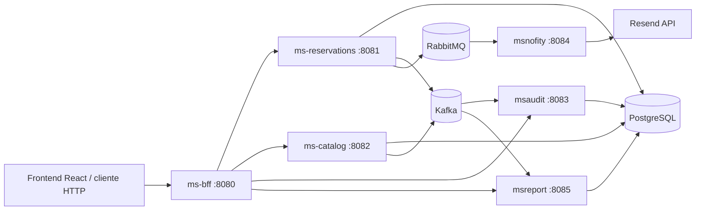
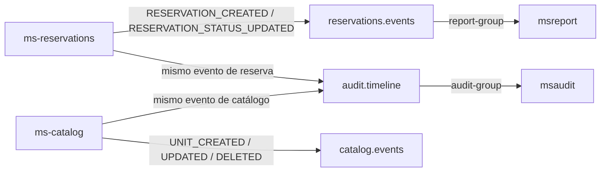

# AndesStay

Plataforma de gestión para una red de hostales, cabañas y lodges. El proyecto centraliza el catálogo de unidades, las reservas, las notificaciones, la auditoría de eventos y los indicadores operacionales mediante una arquitectura de microservicios Spring Boot.

> Este repositorio contiene principalmente el backend. La documentación original menciona un frontend React alojado en Azure y un AWS API Gateway, pero esos componentes no están incluidos en este workspace.

## Arquitectura



### Servicios

| Servicio | Puerto | Responsabilidad |
| --- | ---: | --- |
| `ms-bff` | `8080` | Entrada HTTP para el cliente, autenticación JWT y agregación/proxy hacia los microservicios. |
| `ms-reservations` | `8081` | Crea, consulta y actualiza reservas; valida disponibilidad; publica eventos y comandos. |
| `ms-catalog` | `8082` | Administra unidades, tipos de alojamiento, disponibilidad y datos del catálogo. |
| `msaudit` | `8083` | Consume eventos de auditoría desde Kafka y los persiste en `audit_events`. |
| `msnofity` | `8084` | Consume comandos RabbitMQ para email, housekeeping y vouchers. El nombre del módulo conserva la grafía actual `msnofity`. |
| `msreport` | `8085` | Consume eventos de reservas desde Kafka, los persiste y calcula KPIs. |
| PostgreSQL | `5433` externo / `5432` Docker | Base de datos compartida `andesstay_db`. |
| Kafka | `9092` externo / `29092` Docker | Event streaming para reservas, catálogo y auditoría. |
| RabbitMQ | `5672` y `5673` | Clúster Compose de dos nodos; consolas en `15672` y `15673`. |

Todos los servicios Java usan Maven y Spring Boot. Los Dockerfiles usan Eclipse Temurin 21 para ejecutar las aplicaciones.

## Flujo principal de una reserva

1. El cliente llama a `ms-bff` con un token JWT.
2. El BFF valida el token mediante el issuer configurado y reenvía la operación al microservicio correspondiente.
3. `ms-reservations` valida la unidad contra `ms-catalog` y persiste la reserva en PostgreSQL.
4. La reserva publica eventos Kafka en `reservations.events` y `audit.timeline`.
5. `msreport` consume `reservations.events` para alimentar reportes y KPIs.
6. `msaudit` consume `audit.timeline` y guarda la trazabilidad del actor, evento y agregado.
7. Al confirmar una reserva, `ms-reservations` publica comandos RabbitMQ para email, housekeeping y generación del voucher.
8. `msnofity` consume esos comandos y ejecuta la acción correspondiente.

Las transiciones a `CHECKIN_PENDIENTE` o `EN_ESTADIA` requieren que la reserva haya sido confirmada previamente. Las reservas canceladas son las únicas que pueden eliminarse.

## Kafka

Kafka es la plataforma de **event streaming** del proyecto. Se utiliza para publicar hechos que ya ocurrieron en el dominio, como una reserva creada, una reserva confirmada o una unidad actualizada. El productor no llama directamente al servicio consumidor: publica el evento en un topic y cada grupo de consumidores decide qué copia lógica recibe y cómo la procesa.

Esto lo diferencia de RabbitMQ:

| Tecnología | Uso en AndesStay | Ejemplo |
| --- | --- | --- |
| Kafka | Eventos de dominio, auditoría y reportes. Un mismo evento puede ser leído por varios grupos. | Una reserva se publica para `msreport` y, separadamente, para `msaudit`. |
| RabbitMQ | Comandos dirigidos a una acción concreta. | `ms-reservations` ordena enviar un email a `msnofity`. |

### Conceptos que se utilizan

- **Producer**: microservicio que publica eventos. Son `ms-reservations` y `ms-catalog`.
- **Topic**: canal lógico donde se almacenan los eventos. El proyecto usa `reservations.events`, `audit.timeline` y `catalog.events`.
- **Partition**: división de un topic que permite escalar el procesamiento. El código no fija particiones; Kafka administra la configuración del broker.
- **Key**: identificador usado al publicar. El proyecto usa `reservationId` o `unitId` como clave, para mantener relacionados los eventos de una misma entidad dentro de la partición correspondiente.
- **Consumer**: microservicio que lee eventos. Son `msreport` y `msaudit`.
- **Consumer group**: grupo que coordina consumidores y mantiene sus offsets. `report-group` y `audit-group` son independientes, por lo que ambos pueden recibir eventos sin competir entre sí.
- **Offset**: posición de lectura de un grupo dentro de cada partición. `auto-offset-reset=earliest` permite comenzar desde los eventos disponibles más antiguos cuando el grupo todavía no tiene offset.
- **Serialización JSON**: los productores envían el valor como JSON y los consumidores lo reciben como texto para luego interpretarlo.

### Topics

| Topic | Productor | Consumidor | Uso |
| --- | --- | --- | --- |
| `reservations.events` | `ms-reservations` | `msreport` (`report-group`) | Eventos `RESERVATION_CREATED` y `RESERVATION_STATUS_UPDATED`. |
| `audit.timeline` | `ms-reservations`, `ms-catalog` | `msaudit` (`audit-group`) | Auditoría de reservas y unidades. |
| `catalog.events` | `ms-catalog` | No se observa un consumidor en el código actual | Eventos `UNIT_CREATED`, `UNIT_UPDATED` y `UNIT_DELETED`. |

La topología funcional es:



Kafka no enruta por routing key como RabbitMQ: el productor elige el topic y Kafka conserva el evento para que cada grupo lo lea según sus offsets.

### Eventos publicados por `ms-reservations`

El método `publishReservationEvent(...)` construye un `Map<String, Object>` y lo envía dos veces, a dos topics diferentes, usando el ID de la reserva como clave:

| Evento | Topic | Consumidor | Cuándo se publica |
| --- | --- | --- | --- |
| `RESERVATION_CREATED` | `reservations.events` | `msreport` | Después de crear y guardar una reserva. |
| `RESERVATION_CREATED` | `audit.timeline` | `msaudit` | El mismo momento, para auditoría. |
| `RESERVATION_STATUS_UPDATED` | `reservations.events` | `msreport` | Después de cambiar el estado de una reserva. |
| `RESERVATION_STATUS_UPDATED` | `audit.timeline` | `msaudit` | El mismo momento, para conservar la trazabilidad. |

El payload de una reserva contiene:

```json
{
    "eventType": "RESERVATION_STATUS_UPDATED",
    "reservationId": 123,
    "unitId": 45,
    "guestId": 9,
    "status": "CONFIRMADA",
    "startDate": "2026-09-25",
    "endDate": "2026-09-28",
    "createdAt": "2026-09-23T10:00:00",
    "updatedAt": "2026-09-23T10:05:00",
    "actor": "usuario@ejemplo.com",
    "timestamp": 1710000000000
}
```

El método `publishReservationEvent(...)` está en [KafkaPublisher.java](backend/ms-reservations/src/main/java/com/andesstay/msreservations/messaging/KafkaPublisher.java). Se invoca desde `createReservation(...)` y `updateStatus(...)` en [ReservationService.java](backend/ms-reservations/src/main/java/com/andesstay/msreservations/service/ReservationService.java).

### Eventos publicados por `ms-catalog`

El método `publishUnitEvent(...)` publica los cambios de una unidad en `catalog.events` y también en `audit.timeline`:

| Evento | Topic | Consumidor actual | Cuándo se publica |
| --- | --- | --- | --- |
| `UNIT_CREATED` | `catalog.events` y `audit.timeline` | `catalog.events` no tiene consumidor; `audit.timeline` lo consume `msaudit` | Después de crear una unidad. |
| `UNIT_UPDATED` | `catalog.events` y `audit.timeline` | Igual que el anterior | Después de actualizar una unidad. |
| `UNIT_DELETED` | `catalog.events` y `audit.timeline` | Igual que el anterior | Después de eliminar una unidad. |

El payload de catálogo contiene `eventType`, `unitId`, `name`, `type`, `city`, `availability`, `actor` y `timestamp`. El productor está en [KafkaPublisher.java](backend/ms-catalog/src/main/java/com/andesstay/mscatalog/messaging/KafkaPublisher.java), y se invoca desde `create(...)`, `update(...)` y `delete(...)` en [CatalogService.java](backend/ms-catalog/src/main/java/com/andesstay/mscatalog/service/CatalogService.java).

### Cómo funciona el consumo

- `msaudit` escucha `audit.timeline` con el grupo `audit-group` mediante `consume(...)` en [AuditKafkaListener.java](backend/msaudit/listener/AuditKafkaListener.java). Convierte el texto JSON con `ObjectMapper`, identifica `eventType`, obtiene `reservationId` o `unitId` como agregado y delega en `saveEvent(...)` de [AuditService.java](backend/msaudit/service/AuditService.java), que persiste el evento en PostgreSQL.
- `msreport` escucha `reservations.events` con el grupo `report-group` mediante `consumeReservationEvent(...)` en [ReportEventListener.java](backend/msreport/listener/ReportEventListener.java). Guarda el JSON recibido como un `Report` en PostgreSQL.
- Los KPIs no se calculan directamente dentro del listener. [KpiService.java](backend/msreport/service/KpiService.java) lee los reportes guardados, filtra eventos de tipo `RESERVATION_EVENT` y calcula reservas por hora, ocupación activa y tiempo promedio del ciclo de reserva.
- `msaudit` define su `ConsumerFactory` y `kafkaListenerContainerFactory` en [KafkaConsumerConfig.java](backend/msaudit/config/KafkaConsumerConfig.java), con deserialización de clave y valor como `String`.
- Los grupos `audit-group` y `report-group` son distintos. Por eso `msaudit` y `msreport` reciben sus propios eventos: no se reparten el trabajo entre sí.

### Flujo Kafka de una reserva

| Paso | Qué ocurre | Método y archivo |
| --- | --- | --- |
| 1. Crear reserva | Se guarda la reserva en PostgreSQL y se construye el evento `RESERVATION_CREATED`. | `createReservation(...)` en [ReservationService.java](backend/ms-reservations/src/main/java/com/andesstay/msreservations/service/ReservationService.java) |
| 2. Publicar evento | Se envía el mismo evento a `reservations.events` y `audit.timeline` con `reservationId` como clave. | `publishReservationEvent(...)` en [KafkaPublisher.java](backend/ms-reservations/src/main/java/com/andesstay/msreservations/messaging/KafkaPublisher.java) |
| 3. Generar reporte | `msreport` recibe el evento con `report-group` y lo persiste como reporte. | `consumeReservationEvent(...)` en [ReportEventListener.java](backend/msreport/listener/ReportEventListener.java) |
| 4. Auditar | `msaudit` recibe la copia de `audit.timeline`, extrae el agregado y guarda el payload original. | `consume(...)` en [AuditKafkaListener.java](backend/msaudit/listener/AuditKafkaListener.java) y `saveEvent(...)` en [AuditService.java](backend/msaudit/service/AuditService.java) |
| 5. Cambiar estado | Al confirmar, cancelar o cambiar el estado, se crea `RESERVATION_STATUS_UPDATED` y se repite la publicación en ambos topics. | `updateStatus(...)` en [ReservationService.java](backend/ms-reservations/src/main/java/com/andesstay/msreservations/service/ReservationService.java) |
| 6. Calcular KPIs | Las consultas de reportes leen los eventos persistidos y calculan indicadores sobre el historial disponible. | `getKpis(...)`, `reservationsByHour(...)`, `activeOccupancy(...)` y `averageCycleTimeMinutes(...)` en [KpiService.java](backend/msreport/service/KpiService.java) |

### Configuración y ejecución

Los productores de `ms-reservations` y `ms-catalog` usan `KafkaTemplate<String, Object>` con JSON como serializador de valor. Sus propiedades principales son:

```properties
spring.kafka.bootstrap-servers=localhost:9092
spring.kafka.producer.key-serializer=org.apache.kafka.common.serialization.StringSerializer
spring.kafka.producer.value-serializer=org.springframework.kafka.support.serializer.JsonSerializer
```

Los consumidores de `msaudit` y `msreport` reciben el broker desde `KAFKA_HOST` y usan `localhost:9092` como valor local predeterminado:

```properties
spring.kafka.bootstrap-servers=${KAFKA_HOST:localhost:9092}
spring.kafka.consumer.auto-offset-reset=earliest
```

Los productores usan estas propiedades en [application.properties](backend/ms-reservations/src/main/resources/application.properties) y [application.properties](backend/ms-catalog/src/main/resources/application.properties). Los consumidores las usan en [application.properties](backend/msaudit/src/main/resources/application.properties) y [application.properties](backend/msreport/src/main/resources/application.properties).

En Docker, el broker se anuncia internamente como `kafka:29092` y externamente como `KAFKA_ADVERTISED_HOST:9092`. La definición se encuentra en [docker-compose.messaging.yml](docker-compose.messaging.yml). El contenedor utiliza un único nodo con rol `broker,controller`, replicación 1 y retención configurada de 24 horas o 1 GB. Estas opciones son adecuadas para desarrollo, pero no proporcionan alta disponibilidad de producción.

Para iniciar Kafka:

```powershell
docker compose -f docker-compose.messaging.yml up -d kafka
```

Para confirmar que los consumidores y productores estén conectados, revisar los logs de `msaudit`, `msreport`, `ms-reservations` y `ms-catalog`, además de la configuración de `KAFKA_HOST` en Docker.

## RabbitMQ

RabbitMQ es el broker de mensajería asíncrona utilizado para enviar **comandos de trabajo** entre microservicios. Un productor publica un mensaje y el broker decide a qué cola dirigirlo; el consumidor procesa el mensaje cuando está disponible. Esto desacopla la operación de reservas de tareas secundarias como enviar un email, crear una tarea de housekeeping o generar un voucher.

En este proyecto RabbitMQ no reemplaza a Kafka:

| Tecnología | Papel en AndesStay |
| --- | --- |
| RabbitMQ | Comandos dirigidos a una acción concreta y normalmente a un único consumidor lógico. |
| Kafka | Eventos de dominio y auditoría que pueden ser consumidos por varios grupos de consumidores. |

### Conceptos usados

- **Producer**: aplicación que publica el mensaje. En este caso, `ms-reservations`.
- **Exchange**: punto de entrada que recibe el mensaje y lo enruta; el productor no publica directamente en una cola.
- **Routing key**: clave que el exchange compara con los bindings para decidir la cola destino.
- **Queue**: almacenamiento temporal duradero del mensaje hasta que un consumidor lo procesa.
- **Consumer**: aplicación que escucha una cola. En este caso, `msnofity` mediante `@RabbitListener`.
- **Binding**: relación entre un exchange, una cola y una routing key.
- **DLX/DLQ**: dead-letter exchange y dead-letter queue; reciben mensajes que no pudieron procesarse.

### Topología RabbitMQ

La topología mantiene tres colas principales durables e independientes: `q.housekeeper`, `q.voucher` y `q.email`, cada una con su propia DLQ. Housekeeping y voucher se enrutan mediante un exchange direct; email usa un exchange topic. Los eventos de auditoría de reservas se mantienen en Kafka y no ocupan una cuarta cola RabbitMQ.

| Exchange | Tipo | Cola | Binding/routing key | Acción |
| --- | --- | --- | --- | --- |
| `cmd.direct` | direct | `q.housekeeper` | `housekeeping.ticket` | Procesar housekeeping. |
| `cmd.direct` | direct | `q.voucher` | `voucher.gen` | Generar voucher. |
| `evt.topic` | topic | `q.email` | `notification.#` (productor: `notification.email`) | Enviar notificaciones por email. |
| `cmd.dead.dlx` | direct | `q.housekeeper.dlq` | `q.housekeeper.dlq` | Mensajes fallidos de housekeeping. |
| `cmd.dead.dlx` | direct | `q.voucher.dlq` | `q.voucher.dlq` | Mensajes fallidos de voucher. |
| `cmd.dead.dlx` | direct | `q.email.dlq` | `q.email.dlq` | Mensajes fallidos de email. |

Cada cola principal declara el dead-letter exchange `cmd.dead.dlx` y su routing key `.dlq`. Los nombres, límites y expiración están externalizados bajo `app.rabbitmq.*` en los `application.properties` de `ms-reservations` y `msnofity`; los beans `Queue`, `Exchange` y `Binding` permanecen en las clases `@Configuration`, fuera de productores/consumidores. Ambos servicios comparten los mismos valores para declarar una topología compatible.

Las políticas de retención son:

| Tipo de cola | Máximo de mensajes | Expiración por mensaje | Al alcanzar el límite |
| --- | ---: | ---: | --- |
| Colas principales | 10 000 | 24 horas | El mensaje excedente se deriva a la DLQ de su dominio (`reject-publish-dlx`). |
| DLQ | 10 000 | 30 días | Se conserva como máximo la cantidad indicada; si la DLQ alcanza el límite, RabbitMQ descarta los mensajes más antiguos. |

Los valores se configuran con `app.rabbitmq.queue.max-length`, `app.rabbitmq.queue.message-ttl-ms`, `app.rabbitmq.queue.overflow`, `app.rabbitmq.queue.dlq.max-length` y `app.rabbitmq.queue.dlq.message-ttl-ms`. Los mensajes que expiran en una cola principal también se derivan a su DLQ, donde el listener los registra y confirma; un mensaje de DLQ que cumpla 30 días se elimina automáticamente.

Los consumidores usan ACK manual: confirman después del procesamiento y hacen NACK sin requeue si el error es permanente. Errores de red, timeout y respuestas HTTP `429`/`5xx` se reintentan hasta tres intentos en total, con espera exponencial de `250 ms` y máximo `2000 ms`; JSON malformado, payload inválido y errores HTTP `4xx` van directamente a la DLQ. Los valores están en `app.rabbitmq.listener.retry.*` del `application.properties` de `msnofity`. El listener común de DLQ registra cola, routing key, `x-death` y cuerpo del mensaje y luego ACK, para evitar un ciclo de requeue.

Aunque `ms-catalog` incluye `spring-boot-starter-amqp` y configuración de conexión, no tiene un productor, consumidor ni una configuración de colas RabbitMQ activa en el código actual. Por tanto, su relación actual con RabbitMQ es solo preparatoria.

### Flujo de una reserva

La siguiente trazabilidad muestra qué método participa en cada etapa y dónde se encuentra. Las rutas públicas pasan primero por el BFF; la lógica de negocio vive en `ms-reservations`; RabbitMQ se utiliza únicamente en los pasos marcados como comandos.

| Paso | Qué ocurre | Método y archivo |
| --- | --- | --- |
| 1. Entrada HTTP | El cliente crea una reserva mediante `POST /reservations`. El BFF valida el request y reenvía la petición a `POST /api/reservations`, incluyendo el actor en `X-Actor`. | `create(...)` en [ReservationBffController.java](backend/ms-bff/src/main/java/com/andesstay/msbff/controller/ReservationBffController.java) |
| 2. Controlador de reservas | El microservicio recibe la petición, obtiene el actor y delega la operación al servicio de reservas. | `createReservation(...)` en [ReservationController.java](backend/ms-reservations/src/main/java/com/andesstay/msreservations/controller/ReservationController.java) |
| 3. Validación de unidad | Se comprueba que la unidad exista y que esté disponible para las fechas solicitadas. | `createReservation(...)` en [ReservationService.java](backend/ms-reservations/src/main/java/com/andesstay/msreservations/service/ReservationService.java), que llama a `validateUnitAvailability(...)`, `getUnit(...)` y `checkAvailability(...)` en [UnitValidationService.java](backend/ms-reservations/src/main/java/com/andesstay/msreservations/service/UnitValidationService.java) |
| 4. Persistencia | Se calcula el total, se crea la entidad con estado `CREADA` y se guarda en PostgreSQL. | `createReservation(...)` y `reservationRepository.save(saved)` en [ReservationService.java](backend/ms-reservations/src/main/java/com/andesstay/msreservations/service/ReservationService.java) |
| 5. Email de registro opcional | Si `notifications.email.enabled=true`, se construye un comando `EMAIL_SEND`. Por defecto esta opción está desactivada. | `publishEmailCommand(...)` en [RabbitMQPublisher.java](backend/ms-reservations/src/main/java/com/andesstay/msreservations/messaging/RabbitMQPublisher.java), llamado desde `createReservation(...)` en [ReservationService.java](backend/ms-reservations/src/main/java/com/andesstay/msreservations/service/ReservationService.java) |
| 6. Evento de reserva | Después de guardar la reserva se publican los eventos `RESERVATION_CREATED` en Kafka para reportes y auditoría. | `publishReservationEvent(...)` en [KafkaPublisher.java](backend/ms-reservations/src/main/java/com/andesstay/msreservations/messaging/KafkaPublisher.java) |
| 7. Actualización de estado | Para confirmar la reserva, el cliente usa `PUT /reservations/{id}/status`; el BFF lo reenvía a `PUT /api/reservations/{id}/status`. | `updateStatus(...)` en [ReservationBffController.java](backend/ms-bff/src/main/java/com/andesstay/msbff/controller/ReservationBffController.java) y `updateStatus(...)` en [ReservationController.java](backend/ms-reservations/src/main/java/com/andesstay/msreservations/controller/ReservationController.java) |
| 8. Confirmación | Se valida la transición, se actualiza la entidad y se guarda el nuevo estado. Solo cuando `nextStatus == CONFIRMADA` se generan los comandos RabbitMQ. | `updateStatus(...)` y `reservationRepository.save(updated)` en [ReservationService.java](backend/ms-reservations/src/main/java/com/andesstay/msreservations/service/ReservationService.java) |
| 9. Comando de email | Si las notificaciones están habilitadas, se publica `EMAIL_SEND` con `email`, `subject` y `body`. | `publishEmailCommand(...)` en [RabbitMQPublisher.java](backend/ms-reservations/src/main/java/com/andesstay/msreservations/messaging/RabbitMQPublisher.java) |
| 10. Comando de housekeeping | Se publica `HOUSEKEEPING_TICKET` con `unitId` y `detail`, usando la routing key `housekeeping.ticket`. | `publishHousekeepingTicket(...)` en [RabbitMQPublisher.java](backend/ms-reservations/src/main/java/com/andesstay/msreservations/messaging/RabbitMQPublisher.java) |
| 11. Comando de voucher | Se publica `VOUCHER_GEN` con `reservationId`, `customerEmail`, `voucherCode` y `amount`, usando `voucher.gen`. | `publishVoucherGenCommand(...)` en [RabbitMQPublisher.java](backend/ms-reservations/src/main/java/com/andesstay/msreservations/messaging/RabbitMQPublisher.java) |
| 12. Enrutamiento RabbitMQ | `RabbitTemplate.convertAndSend()` envía housekeeping y voucher a `cmd.direct`, y email a `evt.topic`. | `convertAndSend(...)` en [RabbitMQPublisher.java](backend/ms-reservations/src/main/java/com/andesstay/msreservations/messaging/RabbitMQPublisher.java) y bindings en [RabbitMQConfig.java](backend/ms-reservations/src/main/java/com/andesstay/msreservations/config/RabbitMQConfig.java) |
| 13. Consumo de email | `msnofity` escucha `q.email`, extrae `payload` y llama a Resend para enviar el correo. | `processNotification(...)` en [NotificationListener.java](backend/msnofity/listener/NotificationListener.java), que llama a `sendEmail(...)` en [NotificationService.java](backend/msnofity/service/NotificationService.java) |
| 14. Consumo de housekeeping | `msnofity` escucha la cola dedicada `q.housekeeper` y procesa tickets de limpieza. | `processHousekeeping(...)` en [HousekeepingListener.java](backend/msnofity/listener/HousekeepingListener.java) |
| 15. Consumo de voucher | `msnofity` escucha la cola dedicada `q.voucher` y genera vouchers. | `processVoucher(...)` en [VoucherListener.java](backend/msnofity/listener/VoucherListener.java) |
| 16. ACK, reintento y DLQ | Los listeners confirman con ACK manual al tener éxito. Errores transitorios se reintentan hasta tres veces; errores permanentes o reintentos agotados hacen NACK sin requeue. | [ManualAckMessageProcessor.java](backend/msnofity/messaging/ManualAckMessageProcessor.java) |
| 17. Registro de DLQ | Un consumidor común registra cola, routing key, cabecera `x-death` y payload de los mensajes muertos, luego confirma su recepción. | [DeadLetterListener.java](backend/msnofity/listener/DeadLetterListener.java) |

#### Resumen por escenario

**Crear una reserva (`POST /reservations`)**

`ReservationBffController.create(...)` -> `ReservationController.createReservation(...)` -> `ReservationService.createReservation(...)` -> `UnitValidationService.validateUnitAvailability(...)` -> `reservationRepository.save(...)` -> opcionalmente `RabbitMQPublisher.publishEmailCommand(...)` -> `KafkaPublisher.publishReservationEvent(...)`.

**Confirmar una reserva (`PUT /reservations/{id}/status` con `CONFIRMADA`)**

`ReservationBffController.updateStatus(...)` -> `ReservationController.updateStatus(...)` -> `ReservationService.updateStatus(...)` -> `reservationRepository.save(...)` -> `RabbitMQPublisher.publishEmailCommand(...)` opcional -> `RabbitMQPublisher.publishHousekeepingTicket(...)` -> `RabbitMQPublisher.publishVoucherGenCommand(...)` -> `KafkaPublisher.publishReservationEvent(...)`.

**Procesar los comandos**

RabbitMQ enruta cada mensaje según su routing key y `NotificationListener` recibe el comando. Después delega en `NotificationService`, `HousekeepingService` o `VoucherService`. Actualmente, email sí intenta una integración externa con Resend; housekeeping y voucher solo registran la operación en los logs.

### Formato de los mensajes

Todos los comandos usan un envoltorio JSON con estos campos:

```json
{
    "eventId": "identificador-unico",
    "type": "HOUSEKEEPING_TICKET",
    "timestamp": 1710000000000,
    "traceId": "traza-unica",
    "correlationId": "RES-123",
    "payload": {}
}
```

`eventId` y `timestamp` se generan por defecto en `ms-reservations`; `traceId` identifica la publicación y `correlationId` relaciona el comando con la reserva. El contenido de `payload` depende del comando:

| `type` | Payload principal | Resultado actual en `msnofity` |
| --- | --- | --- |
| `EMAIL_SEND` | `email`, `subject`, `body` | Llama a Resend mediante `https://api.resend.com/emails`. |
| `HOUSEKEEPING_TICKET` | `unitId`, `detail` | Registra el ticket en los logs; aún no lo persiste ni lo envía a otro servicio. |
| `VOUCHER_GEN` | `reservationId`, `customerEmail`, `voucherCode`, `amount` | Registra la generación en los logs; aún no crea un voucher persistente. |

El consumidor de email también contempla el tipo `WEBPUSH`, pero actualmente solo lo registra en logs y el productor de reservas no publica ese comando.

### Microservicios y código relacionado

- `backend/ms-reservations`: dependencia `spring-boot-starter-amqp`, configuración de exchanges/colas/bindings en `RabbitMQConfig` y publicación en `RabbitMQPublisher`. `ReservationService` decide cuándo publicar.
- `backend/msnofity`: conexión y topología en `application.properties`/`RabbitMQConfig`; consumidores separados por dominio en `HousekeepingListener`, `VoucherListener` y `NotificationListener`; ACK/reintentos en `ManualAckMessageProcessor` y registro DLQ en `DeadLetterListener`.
- `backend/ms-catalog`: tiene la dependencia AMQP y propiedades de conexión, pero actualmente no usa RabbitMQ funcionalmente.
- `docker-compose.messaging.yml`: inicia `rabbit1` y `rabbit2` con la misma cookie Erlang y peer discovery estático, en la red compartida `andesstay-messaging`.
- `docker-compose.yml`: conecta los microservicios de mensajería a la red externa `andesstay-messaging` y `ms-reservations`/`msnofity` a ambos nodos mediante `rabbit1:5672,rabbit2:5672`.

### Configuración y ejecución

RabbitMQ se ejecuta como un clúster Docker Compose de dos nodos. El primer nodo queda disponible en los puertos host `5672` (AMQP) y `15672` (Management); el segundo, en `5673` y `15673`. Dentro de Docker, las aplicaciones se conectan a los dos nodos por sus nombres DNS.

| Parámetro | Valor Docker | Valor local predeterminado |
| --- | --- | --- |
| Host de los nodos | `rabbit1`, `rabbit2` | `localhost` |
| Puerto AMQP | `5672`, `5673` (host); `5672` en la red Docker | `5672` |
| Usuario | `RABBITMQ_USER` (por defecto `andesstay`) | `guest` |
| Contraseña | `RABBITMQ_PASSWORD` | `guest` |
| Envío de email desde reservas | `NOTIFICATIONS_EMAIL_ENABLED` (`true` para habilitar) | `false` |
| Consolas de administración | `http://localhost:15672`, `http://localhost:15673` | No aplica |

Antes de iniciar los contenedores, define en tu `.env` local (no lo publiques) `RABBITMQ_USER`, una contraseña fuerte `RABBITMQ_PASSWORD` y una cookie compartida `RABBITMQ_ERLANG_COOKIE` para ambos nodos. Para enviar correos al confirmar reservas, configura además `NOTIFICATIONS_EMAIL_ENABLED=true`, `RESEND_API_KEY` y `RESEND_FROM_EMAIL`; el envío permanece desactivado por defecto para evitar fallos de correo si el proveedor no está configurado. Puedes mantener las variables Kafka/Resend que ya usa el proyecto. La cookie debe ser igual en ambos nodos y mantenerse estable entre reinicios para conservar el clúster.

En AWS EC2, autoriza AMQP (`5672` y, si clientes externos se conectarán directamente al segundo nodo, `5673`) solo desde las IP/redes de clientes que correspondan. Restringe las consolas `15672`/`15673` al acceso administrativo de confianza. La comunicación de clúster debe permanecer en la red privada entre nodos; no expongas puertos de distribución/epmd públicamente.

Si los microservicios se ejecutan en otra máquina/EC2, define `RABBITMQ_ADDRESSES` con la IP privada del host RabbitMQ y ambos puertos publicados, por ejemplo `10.0.1.20:5672,10.0.1.20:5673`. Los nombres `rabbit1`/`rabbit2` solo se resuelven dentro de la red Docker compartida.

Para levantarlo junto con Kafka:

```powershell
docker compose -f docker-compose.messaging.yml up -d
```

Si ya tenías el broker anterior en un contenedor llamado `rabbitmq`, detén ese contenedor antes de iniciar el nuevo clúster porque también ocupa el puerto `5672`. No borres su volumen: los mensajes/topología del broker anterior no se transfieren automáticamente al clúster nuevo.

Para levantar la aplicación completa, ejecutar después:

```powershell
docker compose up -d --build
```

En Docker, `ms-reservations` y `msnofity` intentan conectarse a ambos nodos (`rabbit1:5672,rabbit2:5672`). Ejecutando los servicios fuera de Docker, la conexión local predeterminada usa `localhost:5672`.

Las colas que ya existían antes de esta política se declararon sin estos argumentos. RabbitMQ no permite cambiar algunos argumentos de una cola existente con una nueva declaración: si al actualizar aparece `PRECONDITION_FAILED` por argumentos inequivalentes, detén productores y consumidores, confirma que no haya mensajes pendientes que necesites, y elimina/recrea únicamente las seis colas RabbitMQ para que los servicios las declaren con la nueva política. **Eliminar una cola borra sus mensajes**; no lo hagas si necesitas conservarlos.

### Verificación y diagnóstico

1. Consultar `docker compose -f docker-compose.messaging.yml exec rabbit1 rabbitmqctl cluster_status` y confirmar que aparecen `rabbit@rabbit1` y `rabbit@rabbit2`.
2. Abrir `http://localhost:15672` o `http://localhost:15673` y revisar `cmd.direct`, `evt.topic`, las tres colas y las DLQ.
3. Crear una reserva y comprobar que `ms-reservations` registra la publicación solo si corresponde al estado/configuración.
4. Confirmar una reserva y revisar los logs de `msnofity` para los comandos housekeeping/voucher y el evento de auditoría.
5. Si el email está habilitado, configurar `RESEND_API_KEY` y `RESEND_FROM_EMAIL`; sin esas variables el consumo del email puede fallar.
6. Consultar los logs de `msnofity` para verificar que los consumidores registran mensajes de las DLQ y los confirman después del log. Como el listener las consume enseguida, es normal que la interfaz no muestre mensajes pendientes en ellas.
7. En RabbitMQ Management, revisar cada cola y sus argumentos `x-max-length`, `x-message-ttl` y, para las colas principales, `x-dead-letter-*` y `x-overflow`.

### Pruebas RabbitMQ

En `backend/ms-reservations` hay pruebas Mockito que comprueban que una transición inválida no publica comandos y que las publicaciones válidas usan el exchange y routing key configurados. En `backend/msnofity` hay pruebas unitarias de reintentos y ACK/NACK, más pruebas de integración que inician RabbitMQ con Testcontainers y comprueban routing direct/topic y el envío a DLQ al rechazar sin requeue. Las pruebas de integración se omiten automáticamente si Docker no está disponible.

```powershell
.\backend\ms-reservations\mvnw.cmd -f .\backend\ms-reservations\pom.xml '-Dtest=RabbitMQPublisherTest,ReservationServiceRabbitMQTest' verify
.\backend\ms-reservations\mvnw.cmd -f .\backend\msnofity\pom.xml verify
```

JaCoCo genera cobertura de líneas e instrucciones, entre otras métricas, en `backend/ms-reservations/target/site/jacoco/index.html` y `backend/msnofity/target/site/jacoco/index.html`. El informe `ms-reservations` de arriba limita sus resultados a las pruebas indicadas; `msnofity` ejecuta sus tests unitarios y de integración disponibles. Una prueba de integración que no pueda arrancar Docker se reportará como omitida. Los porcentajes expresan cobertura de código, no cumplimiento funcional de todos los requisitos.

El repositorio todavía no incluye API/controlador de Rabbit admin ni `RabbitAdminService`; por eso no hay pruebas de MockMvc para nombre vacío ni pruebas unitarias del servicio admin. Se deben agregar junto con la implementación real, en vez de crear pruebas desacopladas de código inexistente.

RabbitMQ no garantiza por sí mismo que una operación de negocio y su publicación sean atómicas: la reserva se guarda en PostgreSQL y el comando se publica después desde la misma lógica de servicio. Para producción convendría evaluar confirmaciones del publisher, reintentos controlados, consumidores idempotentes y un patrón outbox.

## API expuesta por el BFF

Todas las rutas del BFF requieren autenticación, salvo que la configuración de seguridad se modifique.

### Reservas

| Método | Ruta | Descripción |
| --- | --- | --- |
| `POST` | `/reservations` | Crear una reserva. |
| `GET` | `/reservations` | Listar reservas; admite `status`, `from` y `to`. |
| `GET` | `/reservations/{id}` | Obtener una reserva. |
| `GET` | `/reservations/by-unit/{unitId}` | Listar reservas de una unidad. |
| `PUT` | `/reservations/{id}/status` | Actualizar el estado. |
| `DELETE` | `/reservations/{id}` | Eliminar una reserva cancelada. |

### Catálogo

| Método | Ruta | Descripción |
| --- | --- | --- |
| `POST` | `/api/units` | Crear una unidad. |
| `GET` | `/api/units` | Listar unidades; admite `type` y `availability`. |
| `GET` | `/api/units/{id}` | Obtener una unidad. |
| `GET` | `/api/units/{id}/availability` | Consultar disponibilidad con `from` y `to`. |
| `PUT` | `/api/units/{id}` | Actualizar una unidad. |
| `DELETE` | `/api/units/{id}` | Eliminar una unidad. |

### Auditoría, reportes y usuario

| Método | Ruta | Descripción |
| --- | --- | --- |
| `GET` | `/audit` | Listar eventos de auditoría. |
| `GET` | `/audit/timeline/{aggregateId}` | Consultar la línea temporal de un agregado. |
| `GET` | `/reports` | Listar reportes almacenados. |
| `GET` | `/reports/kpis` | Obtener todos los KPIs. |
| `GET` | `/reports/kpis/reservations-by-hour` | Reservas agrupadas por hora. |
| `GET` | `/reports/kpis/active-occupancy` | Ocupación activa, basada en reservas `EN_ESTADIA`. |
| `GET` | `/reports/kpis/cycle-time` | Tiempo promedio entre creación y confirmación. |
| `GET` | `/api/users/me` | Obtener los datos del usuario autenticado. |

## Requisitos

- Docker Desktop con Docker Compose.
- Para ejecutar servicios fuera de Docker: JDK 17 o superior y Maven Wrapper.
- Una cuenta y API key de Resend si se desean enviar emails reales.
- Un host anunciado accesible para Kafka cuando se conecten clientes externos al contenedor.

## Configuración

Agrega estas variables a tu `.env` local (no las publiques ni reemplaces las variables Kafka ya existentes):

```dotenv
KAFKA_HOST=kafka:29092
KAFKA_ADVERTISED_HOST=172.31.26.215
RABBITMQ_USER=andesstay
RABBITMQ_PASSWORD=replace-with-a-strong-password
RABBITMQ_ERLANG_COOKIE=replace-with-a-long-random-shared-secret
# Opcional si ms-reservations/msnofity corren fuera de esta red Docker:
# RABBITMQ_ADDRESSES=10.0.1.20:5672,10.0.1.20:5673
```

`KAFKA_ADVERTISED_HOST` debe cambiarse por la IP o DNS que usarán los clientes externos. No se debe publicar una credencial real en el repositorio. Para email, agregar por ejemplo:

```dotenv
RESEND_API_KEY=tu_api_key
RESEND_FROM_EMAIL=onboarding@resend.dev
```

Las configuraciones locales de los servicios usan PostgreSQL en `localhost:5433`, Kafka en `localhost:9092` y RabbitMQ en `localhost:5672`. Dentro de Compose, los servicios usan los nombres DNS de los contenedores.

## Ejecución con Docker Compose

Desde la raíz del repositorio:

```powershell
docker compose -f docker-compose.messaging.yml up -d
docker compose up -d --build
```

Comprobar el estado:

```powershell
docker compose -f docker-compose.messaging.yml ps
docker compose -f docker-compose.messaging.yml exec rabbit1 rabbitmqctl cluster_status
docker compose ps
```

URLs útiles:

- BFF: `http://localhost:8080`
- RabbitMQ Management: `http://localhost:15672` o `http://localhost:15673` (credenciales de `RABBITMQ_USER` / `RABBITMQ_PASSWORD`)
- PostgreSQL: `localhost:5433`
- Kafka externo: `localhost:9092`

Para detener la aplicación:

```powershell
docker compose down
docker compose -f docker-compose.messaging.yml down
```

Para conservar o eliminar los datos de PostgreSQL, recordar que `postgres_data` es un volumen de Docker. `docker compose down -v` lo elimina.

## Wizard de despliegue del backend

El wizard de línea de comandos está en [`scripts/deploy-backend.ps1`](scripts/deploy-backend.ps1). Permite seleccionar:

- `Local`: valida Docker Compose y puede levantar mensajería y todos los microservicios.
- `AWS`: valida AWS CLI, Docker y la identidad activa antes de preparar el despliegue hacia ECR/ECS.
- `Azure`: valida Azure CLI, Docker y la suscripción activa antes de preparar el despliegue hacia ACR/Container Apps.

Para abrir el wizard en Windows:

```powershell
powershell -ExecutionPolicy Bypass -File .\scripts\deploy-backend.ps1
```

Al seleccionar `1. Local`, el wizard ejecuta automáticamente los dos comandos de Docker Compose. Para revisar los comandos sin ejecutarlos:

```powershell
powershell -ExecutionPolicy Bypass -File .\scripts\deploy-backend.ps1 -WhatIf
```

Para apagar automáticamente el backend local y la infraestructura de mensajería:

```powershell
powershell -ExecutionPolicy Bypass -File .\scripts\deploy-backend.ps1 -Target Local -Action Stop
```

Para revisar el apagado sin ejecutarlo:

```powershell
powershell -ExecutionPolicy Bypass -File .\scripts\deploy-backend.ps1 -Target Local -Action Stop -WhatIf
```

El apagado conserva el volumen de PostgreSQL. Para volver a iniciar el backend:

```powershell
powershell -ExecutionPolicy Bypass -File .\scripts\deploy-backend.ps1 -Target Local -Action Start
```

AWS y Azure requieren definir previamente la red, secretos, registro de imágenes, permisos y sizing del entorno. Por eso el wizard valida las herramientas y muestra el siguiente paso sin ejecutar comandos cloud irreversibles automáticamente. Las credenciales deben permanecer en el entorno local o en el proveedor cloud, nunca en el frontend ni en el repositorio.

### Contrato para el frontend externo

El `ms-bff` expone los endpoints autenticados:

- `GET /api/deployments/options`: destinos disponibles y si requieren credenciales cloud.
- `POST /api/deployments/plan`: genera un plan y los comandos del wizard.

Ejemplo de solicitud:

```json
{
  "target": "AWS",
  "projectName": "andesstay",
  "awsRegion": "us-east-1"
}
```

Para Azure, usar `azureResourceGroup` y `azureLocation`. El BFF no ejecuta comandos del sistema ni recibe credenciales; el frontend debe mostrar el plan y dirigir al operador al wizard CLI.

## Ejecución local de un servicio

Primero levantar las dependencias de mensajería y PostgreSQL:

```powershell
docker compose -f docker-compose.messaging.yml up -d
# PostgreSQL también puede levantarse con el compose principal:
docker compose up -d postgres-db
```

Después, desde el directorio de cada microservicio:

```powershell
cd backend/ms-bff
./mvnw.cmd spring-boot:run
```

En PowerShell, repetir el patrón cambiando el directorio por `ms-catalog`, `ms-reservations`, `msaudit`, `msnofity` o `msreport`. Los puertos son los indicados en la tabla de servicios.

## Estructura del repositorio

```text
.
├── backend/
│   ├── ms-bff/             # API Gateway/BFF reactivo
│   ├── ms-catalog/         # Catálogo de unidades
│   ├── ms-reservations/    # Reservas y publicación de eventos/comandos
│   ├── msaudit/            # Auditoría Kafka
│   ├── msnofity/           # Consumidores RabbitMQ y notificaciones
│   └── msreport/           # Reportes y KPIs Kafka
├── docs/
│   └── Arquitectura.MD
├── docker-compose.yml
├── docker-compose.messaging.yml
└── .env
```

## Observaciones del estado actual

- El BFF está preparado para proteger las rutas con JWT de Microsoft Entra External ID/Azure AD.
- El código incluye referencias a un frontend React y a un API Gateway de AWS en la documentación funcional, pero no hay código de frontend ni configuración de API Gateway en este repositorio.
- `catalog.events` tiene productor, pero no se encontró un consumidor activo en el backend.
- `msreport` almacena los eventos recibidos y calcula KPIs a partir de ellos; no es un motor de analítica externa.
- Housekeeping, web push y voucher están implementados como puntos de integración/logging, no como flujos persistidos completos.
- Los nombres de la topología se configuran en ambos servicios; mantener sincronizados sus valores `app.rabbitmq.*` al agregar colas o routing keys.

## Desarrollo y pruebas

Cada módulo Maven tiene su propio `pom.xml`, wrapper Maven y carpeta `src/test`. Para ejecutar las pruebas de un módulo:

```powershell
cd backend/ms-reservations
./mvnw.cmd test
```

Cambiar `ms-reservations` por el módulo que se quiera validar.
