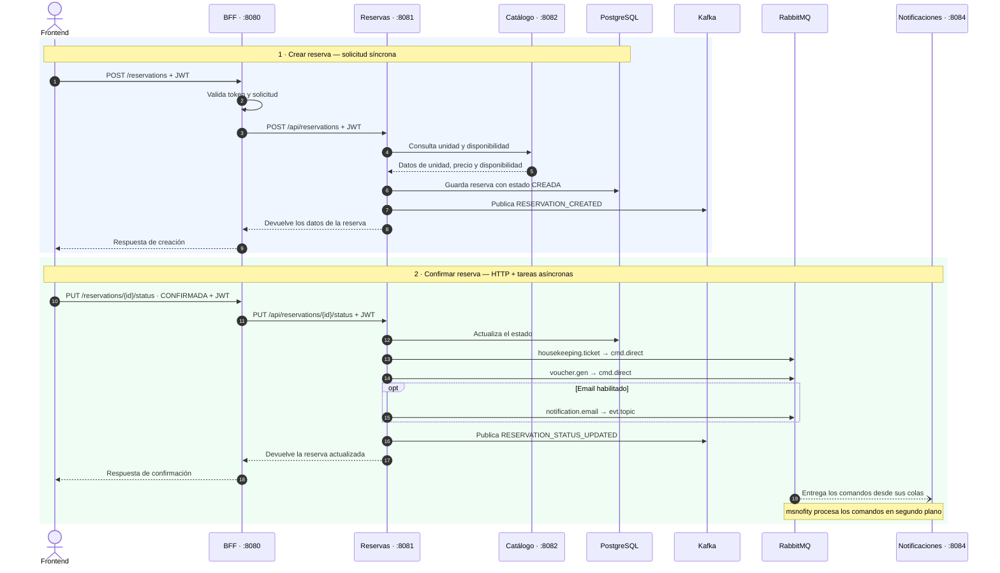
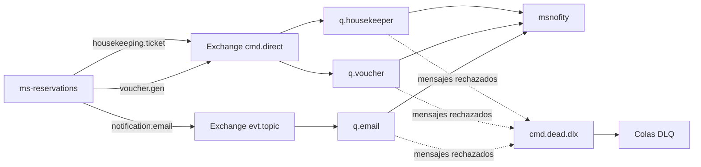

# AndesStay

AndesStay es el backend de una plataforma para administrar alojamientos y reservas. Está construido con microservicios Java y Spring Boot que se comunican mediante APIs y mensajería.

> Este repositorio contiene el backend. El frontend React mencionado en algunos flujos no está incluido.

## Componentes

| Componente | Puerto local | Función |
| --- | ---: | --- |
| `ms-bff` | `8080` | Punto de entrada para las solicitudes del cliente. |
| `ms-reservations` | `8081` | Gestión de reservas. |
| `ms-catalog` | `8082` | Catálogo y disponibilidad de alojamientos. |
| `msaudit` | `8083` | Registro de eventos de auditoría. |
| `msnofity` | `8084` | Procesamiento de notificaciones y tareas asociadas. |
| `msreport` | `8085` | Reportes e indicadores. |
| PostgreSQL | `5433` | Persistencia de datos. |
| Kafka | `9092` | Eventos para auditoría y reportes. |
| RabbitMQ | `5672` | Comandos para notificaciones y tareas. |

El BFF recibe las solicitudes del cliente y las deriva al servicio correspondiente. PostgreSQL guarda los datos; Kafka distribuye eventos y RabbitMQ gestiona comandos asíncronos.

## Flujo de una reserva

El frontend no está en este repositorio; el diagrama muestra cómo se comunicaría un cliente web con las APIs disponibles. La creación y la confirmación son solicitudes separadas: al crear, la reserva queda en estado `CREADA`; al confirmarla, se actualiza el estado y se envían comandos a RabbitMQ.



El recorrido Frontend ↔ BFF ↔ reservas usa HTTP; el backend también consulta el catálogo, persiste los datos y publica eventos. RabbitMQ procesa sus comandos de forma asíncrona: la respuesta al frontend no espera a que housekeeping, voucher o el email terminen.

## Flujo de RabbitMQ

Al confirmar una reserva, `ms-reservations` publica los siguientes comandos. RabbitMQ los enruta por exchange y clave hacia colas distintas:



| Comando | Exchange y clave | Cola | Qué hace hoy `msnofity` |
| --- | --- | --- | --- |
| Preparar habitación | `cmd.direct` / `housekeeping.ticket` | `q.housekeeper` | Registra el ticket de housekeeping. |
| Generar voucher | `cmd.direct` / `voucher.gen` | `q.voucher` | Registra la generación del voucher. |
| Enviar email | `evt.topic` / `notification.email` | `q.email` | Envía el correo mediante Resend si las notificaciones están habilitadas. |

Las colas de trabajo son durables y tienen colas de mensajes fallidos (`q.housekeeper.dlq`, `q.voucher.dlq` y `q.email.dlq`). El envío de email está desactivado por defecto; housekeeping y voucher se procesan, pero actualmente sus servicios registran la operación en los logs, no ejecutan una integración externa.

## Requisitos

- Docker Desktop con Docker Compose.
- Para ejecutar un servicio directamente: JDK 17 o superior.
- Opcional: una API key de Resend si se habilitan los correos electrónicos.

## Configuración

El proyecto carga las variables desde `.env` en la raíz. Antes de iniciar, comprueba que estén definidas las necesarias para el entorno de mensajería:

```dotenv
KAFKA_HOST=kafka:29092
KAFKA_ADVERTISED_HOST=localhost
RABBITMQ_HOST=rabbitmq
RABBITMQ_PORT=5672
RABBITMQ_ERLANG_COOKIE=<valor-local>
RABBITMQ_USER=<usuario-local>
RABBITMQ_PASSWORD=<contraseña-local>
```

Usa una IP o DNS accesible en `KAFKA_ADVERTISED_HOST` si clientes externos se conectarán a Kafka. Para habilitar el envío de correos, configura `RESEND_API_KEY` y `RESEND_FROM_EMAIL`; el correo está deshabilitado por defecto en Compose.

No publiques credenciales reales ni compartas el archivo `.env`.

## Iniciar con Docker Compose

Desde la raíz del repositorio, inicia primero la mensajería y luego los servicios:

```powershell
docker compose -f docker-compose.messaging.yml up -d
docker compose up -d --build
```

Para comprobar el estado:

```powershell
docker compose -f docker-compose.messaging.yml ps
docker compose ps
```

Cuando terminen de iniciar, el BFF está disponible en `http://localhost:8080`. La consola de RabbitMQ está en `http://localhost:15672`; usa las credenciales configuradas en `.env`.

Para detener los servicios y la mensajería:

```powershell
docker compose down
docker compose -f docker-compose.messaging.yml down
```

Estos comandos conservan los volúmenes de datos. `docker compose down -v` elimina los volúmenes asociados y sus datos.

## Ejecutar un servicio localmente

Inicia primero las dependencias necesarias con Docker Compose. Después, desde la carpeta del servicio, ejecuta el wrapper Maven. Por ejemplo, en PowerShell:

```powershell
cd backend\ms-reservations
.\mvnw.cmd spring-boot:run
```

El mismo patrón sirve para los demás módulos de `backend`.

## Pruebas

Cada servicio Maven tiene sus propias pruebas. Para ejecutar las de un módulo:

```powershell
cd backend\ms-reservations
.\mvnw.cmd test
```

Cambia la carpeta para probar otro servicio.

## Estructura

```text
backend/                    Microservicios Spring Boot
docker-compose.yml          Servicios de aplicación y PostgreSQL
docker-compose.messaging.yml Kafka y RabbitMQ
rabbitmq/                   Configuración de RabbitMQ
scripts/deploy-backend.ps1  Asistente de despliegue
```
